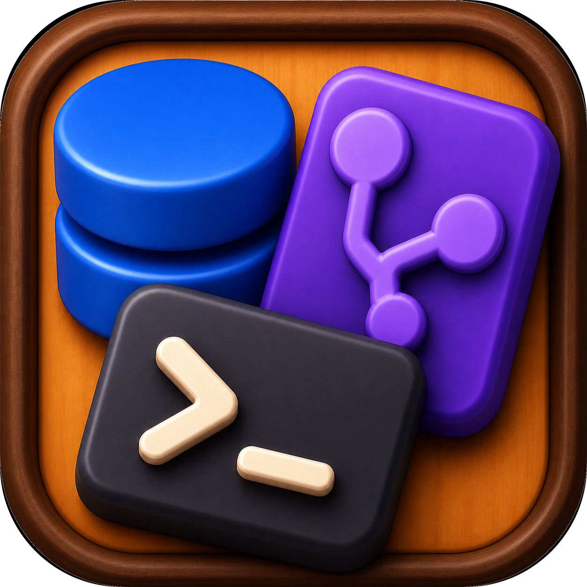
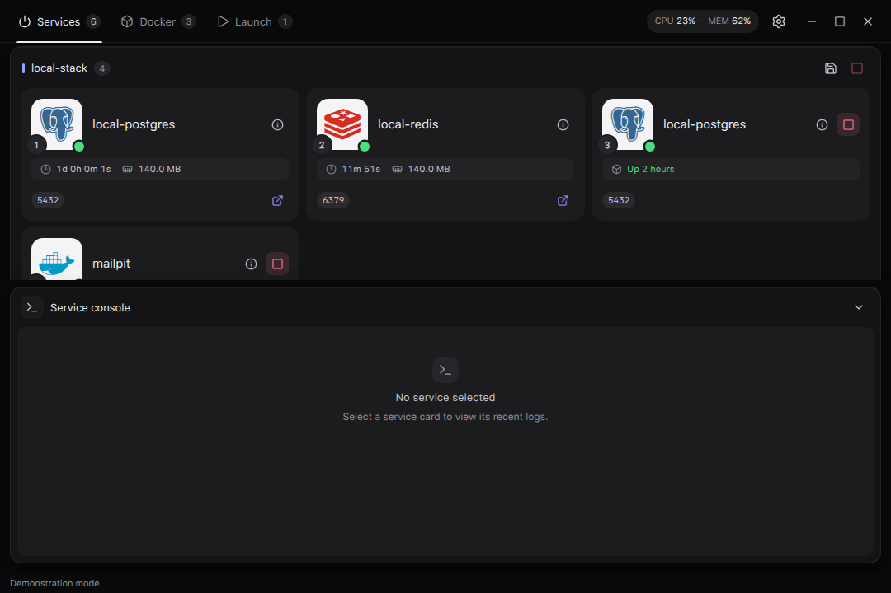
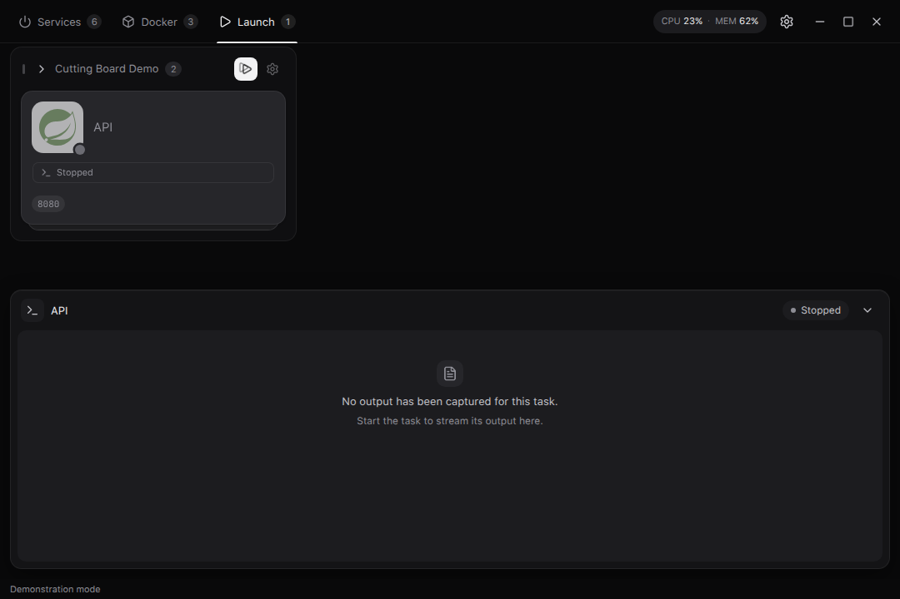

<p align="center">
  
</p>

<h1 align="center">Cutting Board</h1>

<p align="center">A native desktop control board for local development services.</p>

<p align="center">
  Discover what is running, see it by project, and start or stop your own development tasks from one place.
</p>

<p align="center">
  
</p>

## Overview

Cutting Board is a local-first desktop app built with [Tauri 2](https://v2.tauri.app/), a TypeScript/Vite frontend, and a Rust native core. It has no account, cloud sync, telemetry, or login-startup behavior.

- **Services:** finds TCP listeners owned by the current user, groups them by project, and shows their framework, ports, uptime, memory and live console.
- **Docker:** shows containers with their state, Compose project, published ports and logs, and can start or stop them.
- **Launch profiles:** save a project's shell tasks and start, stop or restart them individually or together, with live output and local logs. Spring projects are built before they start, and a failed build during a restart leaves the old process running.
- **Control CLI:** scripts and LLMs can operate saved tasks through the running app.

<p align="center">
  
</p>

## Control CLI

```bash
cutting-board help
```

That prints every command, the JSON responses, the exit codes, and how `wait` decides a task is ready. `cutting-board control list` is the place to start.

## Safety and privacy

Cutting Board only exposes listeners classified as belonging to the current user. Before stopping a discovered service, it revalidates the process identity and refuses to target PID 1 or itself. It sends `SIGTERM` first and `SIGKILL` only if the process does not exit.

Common secrets are redacted from process details. Launch commands are your own shell commands, so review a profile before starting it. Its logs stay local and may contain whatever the program printed.

## Prerequisites

- macOS or Linux, with `lsof` (Linux can fall back to `ss`).
- Node.js 20.19 or newer. Node.js 22.12 or newer is recommended.
- Rust 1.77.2 or newer with the stable toolchain.
- The [Tauri 2 prerequisites](https://v2.tauri.app/start/prerequisites/). Linux builds need the WebKitGTK 4.1 development packages.
- Docker CLI is optional. Without it, the Docker tab is read-only.

## Quick start

```bash
npm install
npm run tauri dev
```

To try it with sample data that changes no real processes:

```bash
npm run tauri dev -- -- --demo
```

On macOS, `npm run tauri build` signs the bundle with an installed Developer ID or Apple Development identity, so privacy permissions survive self-updates. If several match, set `APPLE_SIGNING_IDENTITY` to the one to use.

## Development commands

| Command | Purpose |
| --- | --- |
| `npm run check` | Type-check the frontend. |
| `npm test` | Run the frontend tests. |
| `npm run build` | Type-check and build the frontend. |
| `npm run screenshots -- <outdir>` | Capture the UI headlessly against a running dev server. |
| `npm run icons` | Regenerate runtime and application icons. |
| `cargo fmt --manifest-path src-tauri/Cargo.toml --all -- --check` | Check Rust formatting. |
| `cargo test --manifest-path src-tauri/Cargo.toml --all-targets` | Run the Rust tests. |
| `npm run tauri build` | Build the application bundle. |
| `npm run bump-version -- <x.y.z>` | Set the version. |

`make install`, `make dev`, `make check`, `make test` and `make build` cover the common workflow.

## Local data

`settings.json`, `launch-profiles.json` and captured task output in `logs/` live in the app's config directory and are not synchronized anywhere.

## Changelog

See [CHANGELOG.md](CHANGELOG.md).

## License

MIT. See [LICENSE](LICENSE).
